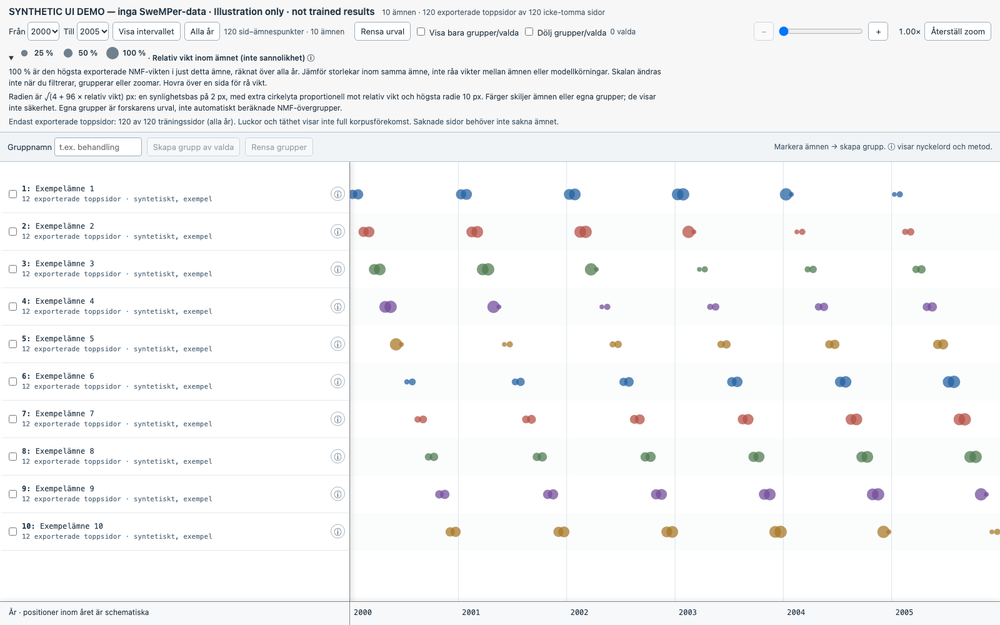
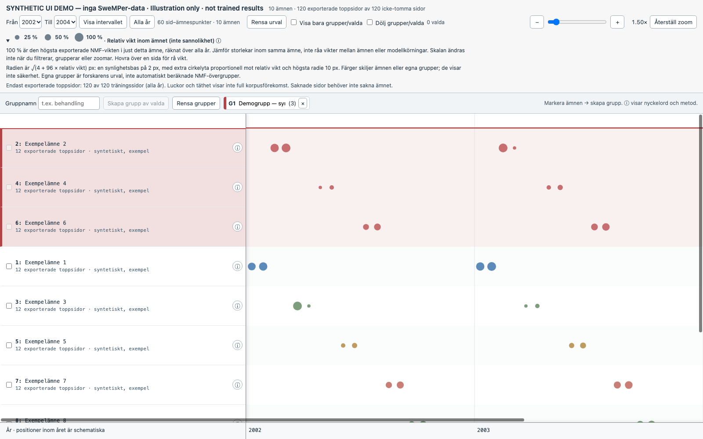

# Synthetic interface previews

These screenshots show the current timeline interface using **entirely synthetic
illustration data**. They are not outputs of a trained model and do not represent
Diabetes, Svenska Läkartidningen or any SweMPer collection. Topic labels, years,
document identifiers, weights and counts are invented solely for this UI preview.
No unpublished OCR, model export or page links were used.

## Overview

The interface provides sticky topic labels and years, year-range filters, zoom,
page-topic circles, a within-topic relative-weight legend and a coverage warning.
All displayed counts in this image describe the synthetic fixture only.

## Named groups and a selected year interval

Selected topics can be collected into named groups; groups remain contiguous at
the top. Filtering and zoom retain the same within-topic size scale. Group names
in this image are also synthetic. Manual groups are display choices, not inferred
higher-level model clusters.

The real renderer, not an illustration editor, produced the UI. A fresh headless
Chrome session captured it at a 1600 × 1000 viewport. Dataset-specific HTMLs,
analysis manifests and descriptive results are deliberately not distributed.
Parameter presets and exact stoplists remain available in the
[modelling guide](../../SWEMPER_MODELLING.md); the
[renderer guide](../../SWEMPER_VISUALISATION.md) explains authorized local use.
