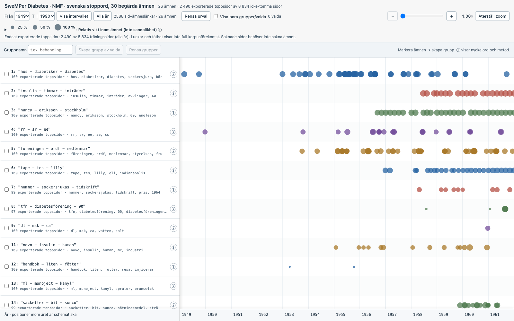
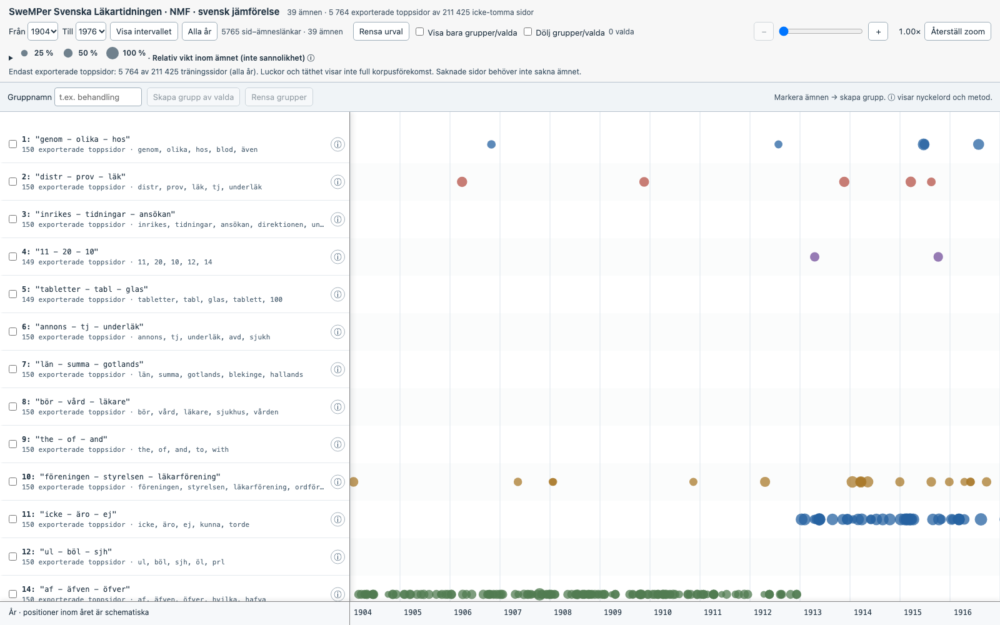

# Actual interface screenshots

These are screenshots of the reviewed Diabetes and Svenska Läkartidningen
interfaces, captured directly in Chrome at 1600 × 1000 and normal 1× zoom.
They contain actual displayed topic labels, years and counts, not synthetic data.
Publication of these static previews was explicitly approved. The corpora remain
unpublished; raw OCR, interactive dataset HTMLs, analysis manifests and model
exports are not distributed.

## Diabetes

## Svenska Läkartidningen

The visible window is only part of each scrollable timeline, not the entire plot.
Controls include year/topic filters, named groups, zoom and a relative-weight
legend. Circle sizes are relative within each topic, not probabilities or a
shared raw-weight scale. Exported top pages do not establish corpus prevalence.

Parameter presets and exact stoplists remain available in the
[modelling guide](../../SWEMPER_MODELLING.md); the
[renderer guide](../../SWEMPER_VISUALISATION.md) explains authorized local use.
